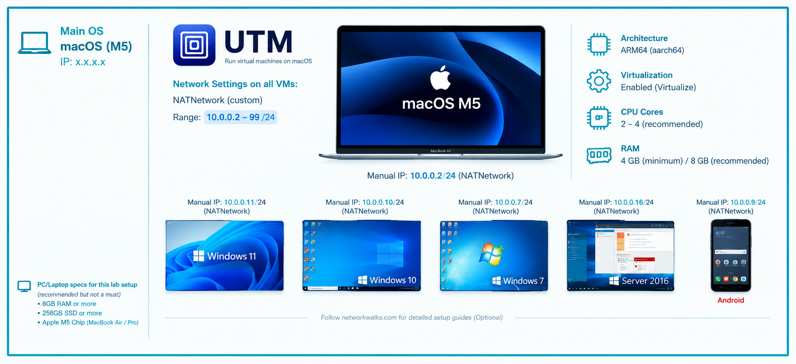
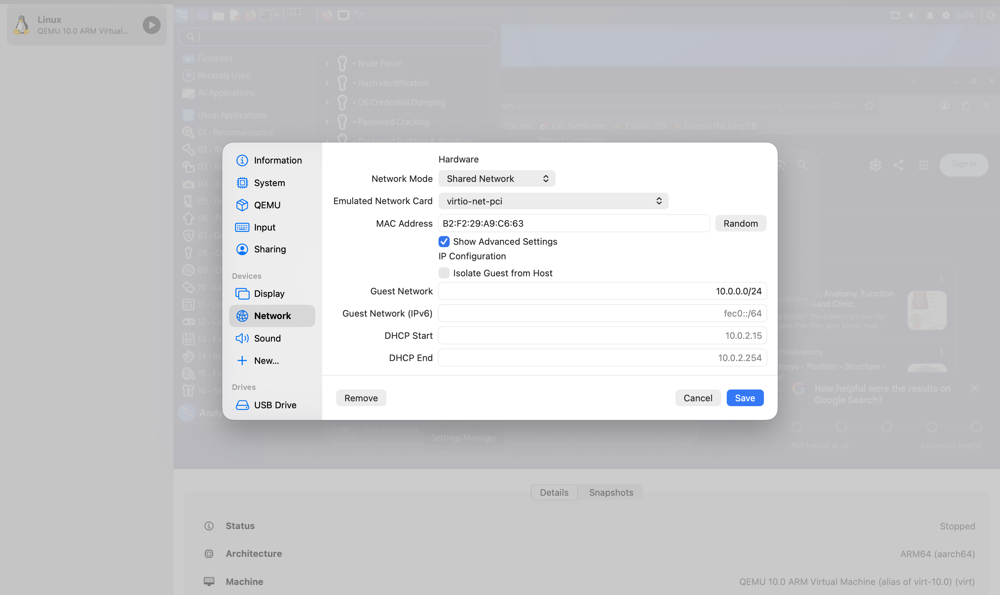
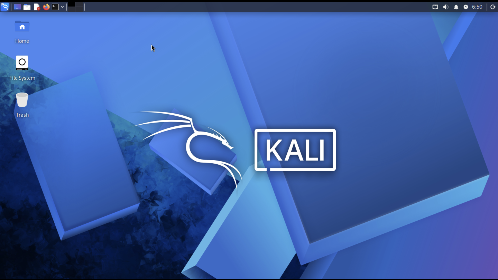
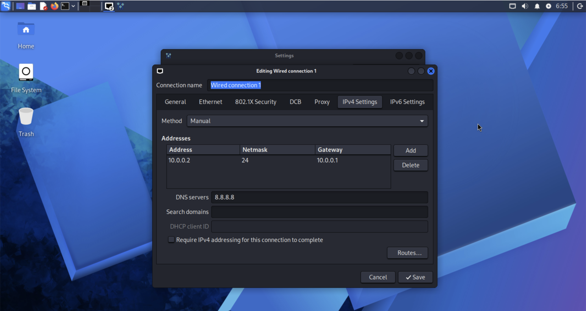

# MacBook M5 Cybersecurity Lab Setup

A dedicated cybersecurity practice lab on an Apple Silicon MacBook Air M5, using **UTM** to run **Kali Linux (ARM64)**. If you are wondering how to set up a VM on an M-series Mac without VirtualBox, this is the route that worked for me.

## 📌 Project Overview

This project documents how I built a reliable, repeatable lab on an ARM-based Mac where network discovery, traffic analysis, vulnerability assessment and other security exercises can be practised in a controlled environment.

The lab uses a private virtual network with a defined IPv4 range. It is designed to support more virtual machines as targets are added, and it keeps lab traffic separate from ordinary home or workplace devices.

## 🎯 Objectives

- Assess virtualisation options compatible with Apple Silicon
- Install and configure UTM on macOS
- Deploy Kali Linux for ARM64 (aarch64) as a virtual machine
- Configure a private virtual network for the lab
- Assign and verify a consistent IPv4 address for Kali Linux
- Test gateway access, internet connectivity and DNS resolution
- Establish a clean recovery point before practical exercises
- Record the configuration, decisions, issues and troubleshooting steps
- Prepare a foundation for future network-security and penetration-testing exercises

## 🛡️ Purpose of the Lab

The lab is an isolated environment for learning and authorised security testing from a MacBook M5, so tools can be tested without touching unauthorised external systems.

Planned uses:

- Network discovery and reconnaissance
- Port scanning and service enumeration
- Vulnerability assessment
- Packet capture and traffic analysis
- Web application security testing
- Controlled exploitation practice
- Security-tool installation and experimentation

## 🏗️ Lab Architecture

The MacBook is the host system. UTM provides the virtualisation layer, and Kali Linux runs as an ARM64 guest. Additional lab machines can be attached to the same virtual network when needed.

## ⚙️ Lab Configuration

| Component | Configuration |
| --- | --- |
| 🖥️ Host OS | macOS |
| 🧠 Host RAM | 16 GB |
| ⚡ Processor | Apple M5 (ARM64) |
| 🧰 Virtualisation | UTM / QEMU |
| 🐉 Security OS | Kali Linux ARM64 (aarch64) |
| 🧠 Kali RAM | 6048 MB |
| 🌐 Virtual Network | UTM custom private network |
| 📡 Network Address | 10.0.0.0/24 |
| 🐧 Kali IP Address | 10.0.0.2/24 |
| 🚪 Default Gateway | 10.0.0.1 |
| 🌍 DNS Server | 8.8.8.8 |
| 🔮 Future VM Range | 10.0.0.3 - 10.0.0.99 |

## 🪜 Lab Setup Procedure

### Step 1. Confirm Apple Silicon compatibility

The host is a MacBook Air with an Apple M5 processor. Apple Silicon uses ARM64, so the virtual machine needs an ARM-compatible OS image and a virtualisation method the Mac supports.

**Host architecture:** Apple Silicon (ARM64)

### Step 2. Test the virtualisation options

I tried VirtualBox first, but the Kali VM would not start in the intended configuration. It threw an architecture compatibility error saying an x86 guest is not supported on the ARM host. Rather than force an unsuitable setup, I switched to UTM.

### Step 3. Install UTM and configure the virtual network

I installed UTM and used it to create the Kali VM. The network is a private custom network, so every lab machine can share the same address range.

| Setting | Value |
| --- | --- |
| Network | Custom private network |
| IPv4 range | 10.0.0.0/24 |
| DHCP / address pool | 10.0.0.2 - 10.0.0.99 |
| Gateway | 10.0.0.1 |

A shared lab subnet gives the VMs a common network to talk over. The exact UTM networking mode matters: Shared Network uses macOS virtual networking, while an emulated network uses a different backend. Whichever mode you pick, keep it and its addressing consistent across all VMs.

This is a starting point for adding target systems and testing communication between machines. Only attach systems that are meant to be in the lab.

### Step 4. Create the Kali Linux virtual machine

I installed Kali in UTM using an ARM64-compatible image, set up for virtualisation on Apple Silicon rather than x86 emulation.

**Key VM settings**

- Architecture: ARM64 (aarch64)
- Virtualisation: Virtualize (where supported)
- Network: connected to the configured lab network
- Devices: UTM/QEMU-compatible defaults unless a lab requirement calls for a change
- Memory: 6048 MB

A shared directory can be set up in UTM when files need to move between macOS and Kali. Only share what the lab needs, and avoid exposing sensitive host folders.

### Step 5. Configure Kali's IPv4 settings

I reviewed the network connection in NetworkManager and set a fixed address so the VM is easy to identify during exercises.

| Setting | Value |
| --- | --- |
| Kali IP address | 10.0.0.2 |
| Subnet mask | 255.255.255.0 (/24) |
| Gateway | 10.0.0.1 |
| DNS | 8.8.8.8 (or the DNS provided by the network) |

A stable address makes Kali easier to spot in scan results, document traffic and set up future targets. Confirm the address is not already in use and is valid for the selected UTM network.

### Step 6. Create a clean UTM recovery point

Once Kali is installed and the network is tested, take a snapshot (or backup) of the VM using UTM.

Suggested name: `Kali - Clean Install and Network Baseline`

The baseline should capture a working install before tools, test data or disruptive changes are added. That makes it easy to return to a consistent state after experiments. Test that the snapshot actually restores before relying on it.

## ✅ Lab Verification

| Test | Command | Expected result |
| --- | --- | --- |
| Check Kali address | `ip -br addr` | Kali shows the intended IPv4 address |
| Check default route | `ip route` | Default route uses the configured gateway |
| Test gateway | `ping -c 4 10.0.0.1` | Replies from the configured gateway |
| Test internet reachability | `ping -c 4 8.8.8.8` | Replies if outbound access is enabled |
| Test DNS resolution | `getent hosts kali.org` | A resolved address is returned |
| Check Nmap | `nmap --version` | Installed Nmap version is displayed |

Record the actual results after running each check. The values below are examples to verify, not a claim that every test has already passed.

- **Kali address:** 10.0.0.2/24 (verify with `ip -br addr`)
- **Configured gateway:** 10.0.0.1 (verify with `ip route`)
- **DNS resolver:** 8.8.8.8 (verify with `resolvectl status` or NetworkManager)

## 🧯 Problems Encountered and Solutions

The main challenge was adapting a normal VM lab workflow to an Apple Silicon Mac. These are the issues I hit and how I got past them.

### Problem 1. VirtualBox guest architecture incompatibility

VirtualBox would not run the x86 Kali VM on the ARM-based MacBook M5. The VM returned an error saying the x86 platform is not supported on the ARM host.

**Resolution:** Use an ARM64 (aarch64) Kali image and run it through UTM's virtualisation support. x86 emulation and ARM virtualisation are not interchangeable, so pick an image that matches the host architecture where possible. UTM was the practical alternative that let the lab move forward.

> **Tip:** Before creating a VM, check the image architecture and confirm whether UTM is set to **Virtualize** or **Emulate**. Virtualize is better for a compatible ARM64 guest. Emulation is generally much slower.

### Problem 2. UTM shared-network interface failed to start

While configuring the custom network, QEMU reported that it could not create the `vmnet` interface. The error showed an invalid-looking address range and subnet mask, which meant the network parameters did not agree with each other.

**Resolution:**

- Review the custom network's address range and use a private /24 subnet for the lab
- Set the network to `10.0.0.0/24`
- Use a valid host range inside that subnet, such as 10.0.0.2 - 10.0.0.99
- Keep the gateway in the same subnet, for example `10.0.0.1`
- Save the corrected settings, then fully shut down and restart the VM

The network started once the subnet was corrected. If vmnet errors come back, check UTM's network mode and macOS permissions instead of only changing Kali's IP settings.

> **Note:** Do not use `10.0.0.0/2`. A /2 prefix describes an enormous network and does not fit a small private lab. /24 is the right size here.

## 💡 What I Learned

Building this lab meant more than following a standard VM install guide. I had to spot a platform limitation, pick a compatible tool, and check the network from both the host and guest sides.

1. **Choosing the right virtualisation approach.** Check the CPU architecture before importing a VM. An x86 image is not automatically compatible with an ARM host. Using an ARM64 Kali image with UTM's virtualisation support was the key to getting this running, and it showed me the difference between virtualisation and emulation.
2. **Building a segmented virtual lab network.** I got hands-on practice defining a private IPv4 subnet, setting a usable host range and gateway, and seeing how UTM's network mode affects VM-to-VM communication and outside access.
3. **Configuring and troubleshooting IPv4.** I practised checking interface addresses, subnet masks, default routes and DNS settings in Kali, and learned to tell a guest OS configuration problem apart from a virtual network problem managed by UTM and macOS.
4. **Planning for safe experimentation and recovery.** A clean snapshot gives me a controlled starting point for testing. It cuts setup time and makes exercises easier to repeat.
5. **Troubleshooting across host and guest systems.** The VirtualBox issue and the UTM vmnet error needed separate investigations. That helped me isolate which layer was causing a problem instead of changing unrelated settings. Clear notes, commands and verification results also make the lab easier to maintain and reproduce.

## 🔒 Security and Ethical Use

This lab is for education and authorised testing only. Keep target machines on the intended lab network, check network boundaries before scanning, and get permission before testing any system outside the environment.

## 🔗 Tools and Resources

- **UTM:** https://mac.getutm.app/
- **Kali Linux downloads (choose an ARM64 image):** https://www.kali.org/get-kali/
- **UTM documentation:** https://docs.getutm.app/

## 👤 Project Author

**Andy Dela Quarshie Wright**
SOC Level 1 Analyst

[LinkedIn](https://www.linkedin.com/in/andywright-security)

## 📋 Project Information

| | |
| --- | --- |
| **Program** | Cybersecurity at Networkwalks |
| **Week** | 01 |
| **Project** | Cybersecurity & Pentesting Lab Setup |
| **Repository** | GitHub |
